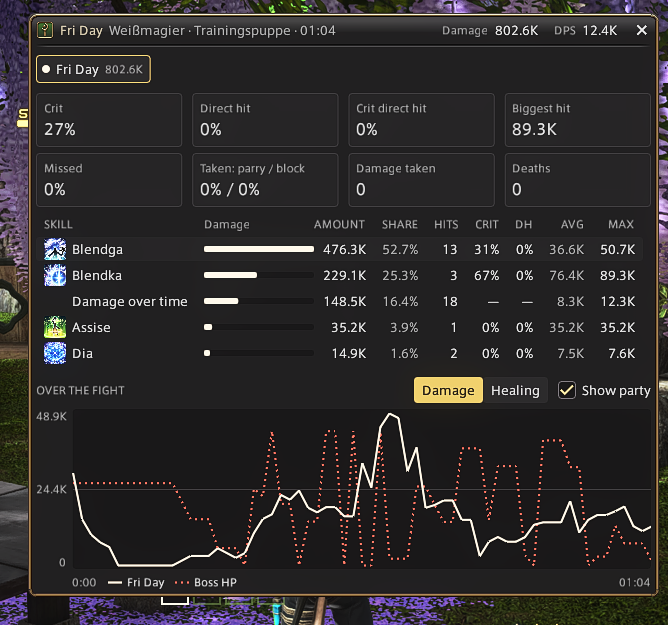
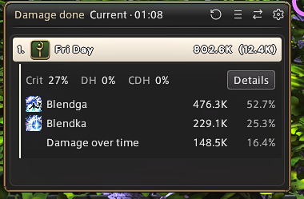

<div align="center">

# WispUI

**Small, careful additions to FINAL FANTASY XIV's own interface, for players who heal, cleanse and keep an eye on the numbers.**

[](https://github.com/NennMichSchinken/WispUI/releases/latest)
[](#requirements)
[](LICENSE)



<!-- later: assets/readme/overview.png — the game's party list with a cleanse and a raise mark, Quick Dispel and the meter -->


</div>

## Why WispUI

- **Stays the game's UI.** WispUI keeps the game's own party list and adds what it is missing, in the game's look. Nothing to relearn, nothing that looks out of place.
- **Made for healers.** A mark on the party list for anyone who needs a cleanse, another for anyone already being raised, and mouseover casting on the list, chosen one spell at a time.
- **Quick Dispel.** A square for every party member lights up when your cleanse would help them. Click it and the cleanse goes to that member, without changing your target.
- **A damage meter with details.** Fed by [IINACT](https://www.iinact.com/). Click a bar for the top skills, or open *Details* for every skill, crit and direct hit rates, and a chart of the fight with your party and the boss's HP.
- **Short option lists.** Good defaults instead of hundreds of switches. Everything is off until you turn it on.



### Also

- Shows on the cast bar when you can start moving without losing the cast
- A ring round the mouse pointer, so you always find it
- The settings window in the game's look, in three styles: Game, Grey and Clear Blue
- Your own colour for every job and role
- Patch notes in the game, each line takes you to its setting
- Mouseover casting and Quick Dispel clicks are off in PvP

<br clear="right">

## Get started

WispUI comes from its own plugin repository, because damage meters are not allowed in the official one.

1. In the game, open the Dalamud settings with `/xlsettings` and go to the **Experimental** tab.
2. Under **Custom Plugin Repositories** (the lower of the two lists), add this URL, click **+**, then **Save**:

   ```
   https://raw.githubusercontent.com/NennMichSchinken/WispUI/main/repo.json
   ```

3. Open the plugin installer with `/xlplugins`, search for **WispUI** and install it.
4. Type `/wisp` to open the settings and turn on what you want.

Updates come through the plugin installer like any other plugin.

### Requirements

- FINAL FANTASY XIV with XIVLauncher and Dalamud (API 15)
- [IINACT](https://www.iinact.com/) for the damage meter only. Without it the meter stays off and shows you how to set it up; everything else works as usual.

## Contact

Questions, ideas or a bug? Write me on **Discord: `nennmichschinken`**, or open an [issue](https://github.com/NennMichSchinken/WispUI/issues).

If something looks wrong, type `/wisp status` right when it happens and send me `%APPDATA%\XIVLauncher\dalamud.log` together with a screenshot.

## What WispUI touches

WispUI does as little as it can:

- **Reads, mostly.** It reads the party, effects and cast bar from the game, the same things the game shows you.
- **Adds to the game's windows, never replaces them.** The cleanse and raise marks and the slidecast window are drawn into the game's own party list and cast bar, and taken out again when you turn them off or unload WispUI.
- **Acts only when you ask.** Mouseover casting redirects only the spells you picked, only while you press them. A Quick Dispel click uses the game's own action call, the same as pressing the button. Both are off in PvP.
- **No data leaves your PC.** WispUI makes no internet connections. The meter reads IINACT inside the game, and fights live in memory until you reset or unload.

<details>
<summary><b>In more detail</b></summary>

- **One hook, only while it is needed.** Mouseover casting sets a single hook on the game's action call when you put a spell on its list, and removes it when the list is empty or the feature is off. It asks the game whether the spell may go to that member before redirecting it.
- **No pointers kept.** Party members and pets are looked up by id at the moment they are used, so a member leaving the zone can never be read after the game freed them.
- **Game windows borrowed, not changed.** The extra parts in the party list and the cast bar reuse the game's own art and are removed on the game's own thread.
- **Stored on disk:** your settings in `%APPDATA%\XIVLauncher\pluginConfigs\WispUI.json`, and nothing else.

</details>

## For developers

<details>
<summary><b>Building</b></summary>

```bash
dotnet build -c Release
```

Add `bin\Release\WispUI.dll` under Dalamud's **Dev Plugin Locations** and reload it after each build. Turn off the installed WispUI first; two copies of the same plugin cannot run together.

</details>

<details>
<summary><b>Releasing</b></summary>

1. Set the version in `WispUI.csproj`.
2. Add one line each to `Data/News.cs` (in-game patch notes), `CHANGELOG.md` and `repo.json` (version and changelog).
3. Merge into `dev`, then `dev` into `main`.
4. Push the tag `vX.Y.Z` on `main`. The release workflow builds it, checks that tag, build and `repo.json` agree, and attaches `WispUI.zip` to the GitHub release.

</details>

## Credits

Concept, design and UX/UI by **NennMichSchinken**. The code was written with the help of AI (Claude) under my direction.

- Icons: [Lucide](https://lucide.dev) (ISC), see [Icons/LUCIDE-LICENSE.txt](Icons/LUCIDE-LICENSE.txt)
- Fonts: Figtree and DM Sans (SIL Open Font License), see [Fonts/](Fonts/)
- Job icons, window art and fonts of the game: **Square Enix**, read from the game at runtime, not shipped
- The damage meter's numbers: [IINACT](https://www.iinact.com/)

FINAL FANTASY is a registered trademark of Square Enix Holdings Co., Ltd. WispUI is a fan project and not affiliated with or endorsed by Square Enix.

## License

MIT, see [LICENSE](LICENSE).
